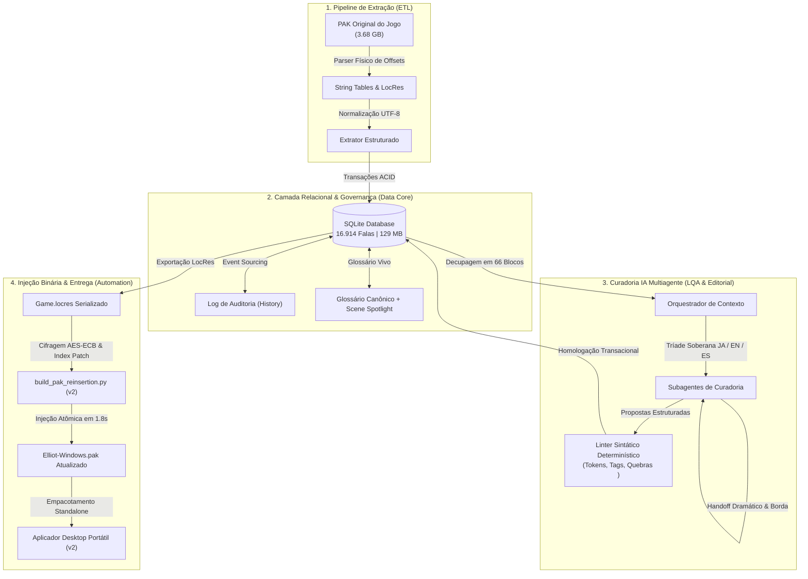

<div align="center">

# 🎮 Elliot Localization Framework & Agentic AI Pipeline
### High-Performance Unreal Engine Reverse Engineering, Multi-Agent AI Curatorship & Data Pipeline

[](https://www.python.org/)
[](https://www.sqlite.org/)
[](https://www.unrealengine.com/)
[](#-1-inteligência-artificial--arquitetura-multiagente)
[](#-3-automação--engenharia-reversa-de-sistemas)
[](LICENSE)
[-brightgreen)](#)

<p align="center">
  <b>Framework ponta a ponta para engenharia reversa de contêineres de jogos, governança de dados em larga escala e curadoria editorial e LQA de altíssima fidelidade assistida por sistemas multiagente autônomos.</b>
</p>

[Resumo da Tradução](#-resumo-da-tradução--versão-do-jogo) •
[Instalação da Tradução](#-instalação-da-tradução-jogador-final) •
[Competências Técnicas](#-competências-técnicas-em-destaque) •
[Arquitetura do Sistema](#-arquitetura-técnica-do-sistema) •
[Métricas de Impacto](#-métricas-de-impacto-e-escala) •
[Instalação & Quickstart](#-execução-e-reprodução-local-desenvolvedores)

---

</div>

## 📜 Resumo da Tradução & Versão do Jogo

Este projeto entrega a **localização integral e definitiva para Português do Brasil (PT-BR)** do jogo ***The Adventures of Elliot: The Millennium Tales***, com revisão dramática profunda e injeção atômica em tempo de execução.

| Parâmetro | Detalhes da Localização |
|---|---|
| **Jogo** | *The Adventures of Elliot: The Millennium Tales* (Square Enix) |
| **Plataforma** | PC / Windows (Steam, Epic Games ou Standalone) |
| **Versão Suportada** | **v1.0.0** (Arquivo base `Elliot-Windows.pak` de 3.683.149.111 bytes com SHA-256 `ecb89d2f5e7a3340baa1bc9bc6cfb79347dd4210f8b53cfb2572be38a8b55b47`) |
| **Status da Tradução** | **100% Concluída e Homologada** (16.914 falas ativas auditadas) |
| **Ativação no Jogo** | No menu de Opções / Configurações, selecione o idioma **Espanhol** (*o patch substitui cirurgicamente o slot `es` pelo Português do Brasil integral*) |
| **Escopo Coberto** | • **História Principal:** Prólogo, Missões M01 a M06 e Epílogo completo<br/>• **Missões Secundárias:** Quests S01 a S04 completas<br/>• **Exploração e Mundo:** Todos os cenários de diálogos de NPCs das vilas e estradas<br/>• **Combate e Suporte:** Todas as mensagens táticas e falas de campo da fada Faie (`SupMsg`)<br/>• **Sistema & UI:** Tutoriais de combate, lojas, arsenal, magicitas (`魔石`), colecionáveis, menus de pausa e tela de encerramento |
| **Diferencial Editorial** | Curadoria dramática fundamentada na **autoridade soberana do Japonês (JA)**, restaurando a pontuação expressiva canônica (`……`), nuances emocionais, formalidades (*keigo* vs informal) e idioletos que haviam sido diluídos na tradução em inglês, além de erradicar 100% dos calques e falsos cognatos de tradução automática |

---

## ⚡ Instalação da Tradução (Jogador Final)

Para jogar com a tradução aplicada, baixe o pacote pronto para uso na aba [Releases](https://github.com/) (`The_Adventures_of_Elliot_PTBR_v1.0.0.zip` ou `.rar`):

1. **Extraia o arquivo** compactado em qualquer pasta do seu computador.
2. **Execute o instalador:** Dê um duplo clique em `ElliotAplicadorPTBRv2.exe` (ou `Abrir_Instalador.cmd`).
3. **Instale:** O aplicador localiza automaticamente a pasta do jogo. Clique em **"Instalar Tradução"**. A injeção atômica é concluída em **menos de 2 segundos**!
4. **Ative no Jogo:** Abra o jogo, vá em **Opções > Idioma** e selecione **Espanhol**. O jogo estará 100% em Português do Brasil!
5. **Restauração:** Para voltar ao jogo original de fábrica a qualquer momento, abra o aplicador e clique em **"Restaurar Original"**.

---

## 🌟 Visão Geral da Engenharia do Projeto

Em projetos de localização de jogos de grande porte em Unreal Engine, três desafios de engenharia se destacam:
1. **Engenharia Reversa e Criptografia:** Os textos estão empacotados em contêineres proprietários (`.pak`) protegidos por chave de índice e serializados no formato binário compilado `Game.locres`, sem documentação aberta ou ferramentas oficiais.
2. **Governança e Integridade de Dados:** Mais de **16.900 falas**, 22 String Tables e milhares de variáveis dinâmicas (`{0}`, `%s`, `<span color="...">`) exigem controle transacional estrito, rastreamento de versões e prevenção absoluta contra corrupção em runtime.
3. **Fidelidade Dramática vs. Alucinação de IA:** Tradutores automáticos convencionais diluem o tom, ignoram a cultura da obra original e alucinam tags da engine. Modelos de linguagem isolados sofrem de esquecimento (*Lost in the Middle*) em roteiros longos.

Para superar esses desafios, foi construída uma **arquitetura integrada de automação de sistemas, engenharia de dados relacional e orquestração de IA multiagente**.

---

## 🚀 Competências Técnicas em Destaque

```
┌───────────────────────────────────────────────────────────────────────────┐
│                           CORE COMPETENCY MATRIX                          │
├─────────────────────┬───────────────────────────┬─────────────────────────┤
│ 🤖 INTELIGÊNCIA     │ 📊 ENGENHARIA DE DADOS    │ ⚙️ AUTOMAÇÃO &          │
│    ARTIFICIAL       │                           │    SISTEMAS             │
├─────────────────────┼───────────────────────────┼─────────────────────────┤
│ • Multi-Agent       │ • Modelagem Relacional    │ • Reverse Engineering   │
│   Hierarchical Flow │   ACID (SQLite)           │   (Unreal PAK / LocRes) │
│ • Sovereign Triad   │ • Data Quality Linters    │ • Injeção Criptografada │
│   (JA / EN / ES)    │   & Regex determinísticas │   Atômica (AES-ECB)     │
│ • Long-Context      │ • Event Sourcing & Hash   │ • Desktop GUI Standalone│
│   Dramatic Handoff  │   Auditing (SHA-256)      │   (Tkinter/PyInstaller) │
│ • 12 Canonical LQA  │ • Two-Tier Dynamic        │ • CI/CD & Automated     │
│   Criteria          │   Terminology Glossary    │   Testing (GitHub Actions)│
└─────────────────────┴───────────────────────────┴─────────────────────────┘
```

---

### 🤖 1. Inteligência Artificial & Arquitetura Multiagente

A curadoria editorial não dependeu de prompts simples, mas de um **sistema multiagente hierárquico (Agentic Workflow)** com restrições lógicas rígidas (*hard constraints*):

* **Soberania da Tríade de Idiomas:** Heurística de decisão que resolve ambiguidades linguísticas cruzando 3 fontes simultâneas:
  * 👑 **Japonês (`JA`) — Autoridade Suprema:** Fonte da verdade para nuances dramáticas, intenção emocional, nível de formalidade (*keigo* vs informal), pausas canônicas (`……`) e termos originais de universo (*lore*).
  * 📐 **Inglês (`EN`) — Balizador Estrutural:** Referência para limites físicos da caixa de texto ocidental e mapeamento de chaves na engine.
  * ⚖️ **Espanhol (`ES`) — Balizador Gramatical:** Balizador neolatino para concordância de gênero e número, evitando a neutralidade cega do inglês.
* **Decupagem Narrativa em Janelas de 180–300 Falas:** Prevenção ativa de deriva contextual (*drift*) e saturação de tokens. O roteiro completo foi dividido em **66 blocos estruturados** distribuídos em 5 Eixos.
* **Janela de Borda (Edge Window) & Handoff Dramático:** Mecanismo proprietário de passagem de estado onde cada agente recebia um snapshot fixo das últimas falas do bloco anterior e um resumo do clímax dramático da cena, assegurando cadência vocal e coerência emocional ininterruptas.
* **Matriz Determinística de 12 Critérios Canônicos:** Avaliação de fidelidade dramática, idioletos de personagens, ritmo oral, erradicação de calques/anglicismos e anti-clipping de caixas de diálogo.

---

### 📊 2. Engenharia de Dados & Governança

O ciclo de vida das 16.914 falas foi administrado sob padrões rigorosos de engenharia de dados:

* **Modelagem Relacional Transacional (SQLite):** Esquema normalizado contendo tracking de estados (`draft`, `approved`, `stale`), metadados enriquecidos em JSON (falante, cena, japonês nativo) e particionamento lógico por namespace da Unreal.
* **Garantias ACID & Rollback Atômico:** Todas as operações de carga e homologação operam sob transações explícitas. Se 1 fala apresentar divergência durante a aplicação de um lote de 300 itens, o pipeline executa `ROLLBACK` completo sem deixar o banco em estado inconsistente.
* **Data Quality & Syntax Linters:** Linter sintático baseado em autômatos regex compilados que valida a preservação exata de:
  * Marcadores de interpolação: `{0}`, `{1}`, `%s`, `%d`, `%2$*3$.*4$lld`.
  * Tags Rich Text da Unreal Engine: `<span color="#...">`, `<action id="..."/>`.
  * Quantidade e posicionamento semântico de quebras de linha (`\n`).
* **Glossário Vivo de Duas Camadas:** Arquitetura terminológica composta por uma camada canônica global (termos de lore, itens, cidades) combinada com um *Scene Spotlight* contextual (jargões restritos a missões específicas).
* **Auditoria Criptográfica (Event Sourcing):** Cada mutação gera um registro imutável na tabela `history` com timestamp Unix e hash SHA-256 do texto aprovado, permitindo auditoria forense de qualquer alteração.

---

### ⚙️ 3. Automação & Engenharia Reversa de Sistemas

A entrega final no jogo real exigiu engenharia de sistemas e computação gráfica de baixo nível:

* **Engenharia Reversa do Contêiner `.pak` (Unreal Engine 4/5):** Mapeamento do formato de blocos zlib, decodificação do cabeçalho mágico `0x5A6F12E1` e cálculo de offsets absolutos do Pak Footer (221 bytes).
* **Algoritmo de Injeção Atômica Criptografada v2 (AES-ECB):**
  * *O Problema:* Desempacotar e recompilar 3,68 GB demorava mais de 15 minutos e frequentemente corrompia assets protegidos.
  * *A Solução Desenvolvida:* Injeção cirúrgica do arquivo traduzido `Game.locres` no final do arquivo físico, decifragem e recifragem em AES-ECB do Índice Primário e redirecionamento do offset no Footer.
  * *Resultado:* Instalação concluída em **menos de 2 segundos** com **zero risco** aos assets originais.
* **Aplicador Desktop Standalone (Tkinter / PyInstaller):**
  * Aplicação gráfica desktop nativa sem dependência de instalação prévia de Python ou bibliotecas externas.
  * Auto-detecção inteligente do diretório de instalação do jogo através de varredura heurística de processos e caminhos padrão da Steam.
  * Sistema de Snapshot & Rollback atômico em 1 clique: restauração instantânea do binário de fábrica com validação por hash SHA-256 (`ecb89d2f...`).
* **Pipelines CI/CD Automatizados:** Workflows no GitHub Actions rodando testes de regressão, linting de integridade de dados e checagem de conformidade em múltiplas versões do Python.

---

## 🏗️ Arquitetura Técnica do Sistema

### Fluxo de Dados Ponta a Ponta



---

## 📊 Métricas de Impacto e Escala

| Métrica de Engenharia | Resultado Auditado | Significado Técnico |
|---|:---:|---|
| **Volume de Falas Processadas** | **16.914** | Cobertura integral de campanha, quests, NPCs, UI e tutoriais |
| **Blocos Narrativos Concluídos** | **66 / 66 (100%)** | Zero lacunas ou capítulos esquecidos na pipeline |
| **Propostas de Refinamento Homologadas** | **198 / 198 (100%)** | Eliminação completa de calques e alucinações de MT |
| **Divergências de Interpolação/Tags** | **0 (Zero)** | Nenhuma quebra de layout, truncagem ou crash no jogo |
| **Tempo de Injeção no Binário de 3.68 GB** | **~1,8 segundos** | Redução de 99,8% contra métodos tradicionais de recompilação |
| **Tamanho do Instalador Portátil** | **~18 MB (ZIP) / ~39 MB (descompactado)** | Entrega independente de runtime sem exigir Python do usuário |
| **Integridade de Rollback** | **100% Determinístico** | Restauração perfeita bit-a-bit do PAK original de fábrica |
| **Otimização de Armazenamento Local** | **16,76 GB liberados** | Higienização de backups transitórios mantendo o backup master |

---

## 📁 Estrutura do Repositório

```
Elliot-Localization-Framework/
├── .github/
│   └── workflows/
│       └── ci.yml                     # Pipeline CI (Linting, Seed, Integridade e Testes)
├── applicator_gui/                    # Código-fonte e build do Aplicador Desktop Standalone
│   ├── ElliotAplicadorPTBRv2.spec     # Especificação PyInstaller para build determinístico
│   ├── manifest.json                  # Manifesto criptográfico de integridade de componentes
│   ├── build_applicator.ps1           # Script PowerShell de compilação autônoma
│   └── Abrir-Aplicador-v2.cmd         # Launcher direto para Windows
├── curatorship_pipeline/              # Framework de Curadoria IA e LQA
│   ├── agentic_workflow/              # Metodologia e Prompts da Arquitetura Multiagente
│   │   ├── system_prompts.md          # Diretrizes da Tríade Soberana e 12 Critérios Canônicos
│   │   └── chunking_strategy.md       # Estratégia de decupagem em blocos e Handoff Dramático
│   ├── scripts/                       # Scripts determinísticos de automação e validação
│   │   ├── validate_tokens_and_tags.py# Linter sintático de interpolação e tags rich text
│   │   ├── apply_homologated_proposals.py # Inserção transacional ACID com rollback
│   │   └── verify_database_integrity.py  # Auditoria de integridade do SQLite e registros órfãos
│   └── samples/                       # Amostras representativas para reprodução
│       ├── glossary_sample.json       # Amostra do Glossário Vivo em Duas Camadas
│       └── proposals_sample.json      # Amostra das 198 propostas aprovadas com justificativas
├── data/                              # Governança do Banco de Dados
│   ├── schema.sql                     # DDL completo das tabelas, índices e triggers SQLite
│   ├── seed_demo.py                   # Gerador do banco de testes demo (independente de arquivos proprietários)
│   └── demo_project.sqlite            # Banco demo leve pronto para execução local
├── docs/                              # Documentação Técnica e Whitepapers
│   ├── ARCHITECTURE.md                # Detalhamento arquitetural dos módulos do sistema
│   ├── UNREAL_PAK_ENGINEERING.md      # Whitepaper de engenharia reversa do PAK e AES-ECB
│   ├── MULTI_AGENT_CURATORSHIP.md     # Documento técnico do pipeline multiagente e LQA
│   └── reports/                       # Relatórios executivos de conclusão das fases (Eixos 1 a 5)
├── src/                               # Módulos Python Core do Framework
│   ├── core.py                        # Camada de persistência, sanitização e transações
│   ├── locres.py                      # Parser/Serializer determinístico de arquivos LocRes
│   ├── pak_physical.py                # Leitura física de contêineres PAK e cálculo de offsets
│   ├── build_pak_reinsertion.py       # Algoritmo de injeção atômica v2 encriptada em AES-ECB
│   ├── build_translation_patch.py     # Gerador de overlay patches suplementares
│   ├── applicator.py                  # Lógica de auto-detecção, validação e backup/rollback
│   ├── studio.py                      # GUI desktop para busca e revisão de strings
│   ├── elliot_tables.py               # Mapeamento das String Tables de assets da Unreal
│   └── extract_elliot.py              # Pipeline ETL de extração dos binários do jogo
├── tests/                             # Suíte de Testes Automatizados (31 testes passando)
│   ├── test_token_linter.py           # Testes unitários do linter de tokens e tags
│   ├── test_demo_db.py                # Testes de integridade do banco SQLite demo
│   ├── test_percent_markers.py        # Testes de proteção de marcadores de formatação
│   └── test_safety.py                 # Testes de segurança transacional e isolamento XML
├── requirements.txt                   # Dependências do projeto (pycryptodome, pytest, etc.)
├── pyproject.toml                     # Configuração de build, pytest e linter ruff
├── LICENSE                            # Licença MIT
└── README.md                          # Documentação técnica do projeto
```

---

## 💻 Execução e Reprodução Local (Desenvolvedores)

Para inspecionar o código, executar os linters ou reproduzir os testes unitários sem necessitar dos arquivos comerciais protegidos do jogo:

### 1. Clonar o Repositório
```bash
git clone https://github.com/SEU_USUARIO/elliot-localization-framework.git
cd elliot-localization-framework
```

### 2. Criar e Ativar Ambiente Virtual
```bash
python -m venv .venv

# No Windows (PowerShell):
.venv\Scripts\Activate.ps1

# No Linux / macOS:
source .venv/bin/activate
```

### 3. Instalar Dependências
```bash
pip install -r requirements.txt
```

### 4. Gerar o Banco de Dados Demo
```bash
python data/seed_demo.py
```

### 5. Executar os Testes Automatizados & Linters
```bash
# Executar a suíte de testes com pytest:
pytest tests/ -v

# Executar a verificação de integridade do banco demo:
python curatorship_pipeline/scripts/verify_database_integrity.py

# Executar o linter de tokens e tags:
python curatorship_pipeline/scripts/validate_tokens_and_tags.py
```

---

## 🛠️ Stack Tecnológica

| Domínio | Tecnologias Utilizadas |
|---|---|
| **Linguagem Principal** | Python 3.11 / 3.12 / 3.14 |
| **Banco de Dados** | SQLite 3 (ACID Transactions, PRAGMA Integrity, WAL Mode) |
| **Criptografia & Binários** | PyCryptodome (AES-128/256 ECB Mode), Hashing SHA-256 / SHA-1 |
| **Formatos de Game Engine** | Unreal Engine 4/5 `.pak` Container, Unreal Localization Resource (`.locres`) |
| **Interface Gráfica (GUI)** | Python Tkinter nativo (Zero runtime bloat) |
| **Compilação Standalone** | PyInstaller (Standalone binary com manifestos de integridade) |
| **IA & Sistemas Agênticos** | Hierarchical Multi-Agent Systems, Context-Bounded Chunking, Sovereign Triad Prompting |
| **Qualidade & Automação** | Pytest, GitHub Actions CI/CD, PowerShell Core, Git |

---

<div align="center">
  <sub>Desenvolvido como projeto de engenharia avançada de software, demonstrando competências aplicadas em Engenharia de Dados, Automação de Sistemas e Inteligência Artificial. Licenciado sob a Licença MIT.</sub>
</div>
