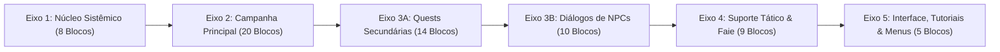
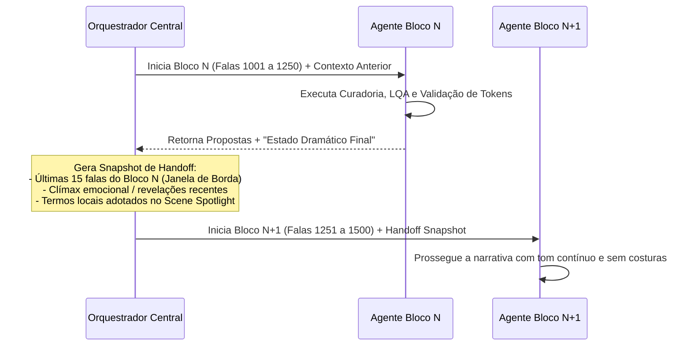

# Arquitetura de Decupagem Narrativa & Handoff Dramático

Este documento descreve a estratégia de segmentação de contexto em larga escala e orquestração de subagentes para processamento de mais de 16.000 falas com coerência de longo prazo.

---

## 1. O Problema do Esquecimento e Deriva Contextual em LLMs

Modelos de linguagem, mesmo com janelas de contexto amplas, sofrem de perda de atenção intermediária (*Lost in the Middle*) e deriva de personalidade ao processar roteiros extensos de RPGs. Se o agente recebe 5.000 falas de uma vez:
1. Começa a esquecer apelidos e gírias de personagens introduzidos no início.
2. Altera o tom de voz e formalidade ao longo do texto.
3. Degenera a pontuação expressiva (`……` vira `...` ou `.`).

---

## 2. A Solução: Decupagem em Janelas de 180–300 Falas com Context Boundary

O roteiro do jogo foi particionado em **66 blocos estruturados** distribuídos em 5 Eixos Narrativos e Sistêmicos:

### Anatomia de um Bloco de Processamento:
Cada bloco possui entre **180 e 300 falas**, tamanho ótimo que permite ao LLM manter:
1. Raciocínio profundo e atenção total a cada nuance sem saturação de tokens.
2. Análise comparativa simultânea da Tríade de Idiomas (`JA`, `EN`, `ES`).
3. Execução imediata de verificações determinísticas de sintaxe e tags.

---

## 3. Janela de Borda (Edge Window) e Handoff Dramático

Para evitar rupturas abruptas de contexto entre o Bloco $N$ e o Bloco $N+1$, implementamos o conceito de **Handoff Dramático**:

### Componentes do Pacote de Handoff:
- **Janela de Borda (Overlap de 10 a 20 falas):** O novo agente lê as últimas falas do bloco anterior como leitura obrigatória (sem editá-las), garantindo continuidade na cadência das réplicas.
- **Relatório de Estado Dramático:** Resumo sucinto do tom da cena (ex: "Elliot acabou de descobrir a verdade sobre seu pai; o clima é de choque e luto contido").
- **Glossário de Cena (*Scene Spotlight*):** Termos e jargões exclusivos introduzidos naquele capítulo.
