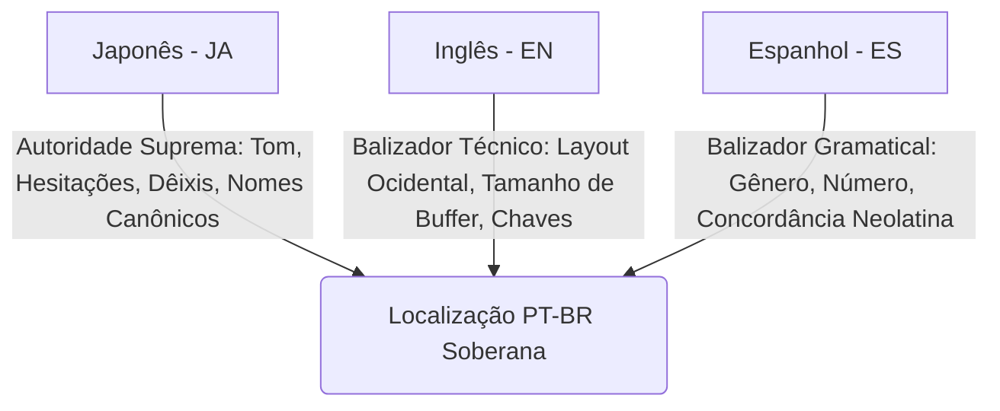

# Arquitetura Multiagente: Tríade Soberana & Prompts de Curadoria LQA

Este documento define o framework conceitual e os prompts canônicos de sistema utilizados pela orquestração de subagentes autônomos na curadoria editorial e LQA de *The Adventures of Elliot: The Millennium Tales*.

---

## 1. O Princípio da Tríade Soberana de Idiomas

A localização de jogos orientais frequentemente falha quando se apoia unicamente na tradução intermediária em inglês, que tende a diluir hesitações, formalidades e subtextos emocionais. Para resolver esse problema estrutural, desenhamos uma hierarquia algorítmica e editorial estrita:



1. **Japonês (`JA`) — Autoridade Suprema:**
   - Determina a intenção dramática, nível de polidez (*keigo* vs fala informal), termos de universo (*lore*), pontuação expressiva (`……` reticências duplas canônicas), onomatopeias e dêixis.
2. **Inglês (`EN`) — Balizador Técnico e Estrutural:**
   - Utilizado como referência de limites espaciais de UI ocidental e identificação de referências no código da Unreal Engine.
3. **Espanhol (`ES`) — Balizador Gramatical Neolatino:**
   - Referência de concordância de gênero e número, evitando a neutralidade cega do inglês anglo-saxão.

---

## 2. Os 12 Critérios Canônicos de LQA Editorial

Cada subagente opera sob uma matriz determinística de avaliação composta por 12 critérios:

1. **Fidelidade à Intenção Dramática (`CRIT_01`):** Subtexto e emoção guiados pela autoridade japonesa.
2. **Registro e Idioleto (`CRIT_02`):** Cada personagem possui voz única (ex: Elliot jovem e determinado; Faie expressiva e enérgica; Anciãos solenes).
3. **Pontuação Canônica Expressiva (`CRIT_03`):** Preservação rigorosa de `……` (reticências de pausa dramática japonesa de 2 ou 4 caracteres) em vez de reticências ocidentais simples de 3 pontos quando expressam hesitação.
4. **Preservação de Tokens e Tags (`CRIT_04`):** Tolerância zero para alteração de `{0}`, `%s`, `<span color="...">` ou `<action id="..."/>`.
5. **Ritmo e Prosódia Oral (`CRIT_05`):** Textos naturais para leitura visual rápida e sincronia labial/caixas de diálogo.
6. **Consistência Terminológica Global (`CRIT_06`):** Aderência absoluta ao Glossário Canônico de Lore (ex: *Magicita*, *Bloqueio Perfeito*, *Batalha do Milênio*).
7. **Scene Spotlight Contextual (`CRIT_07`):** Termos e gírias de missões e regiões específicas mantidos no escopo correto.
8. **Erradicação de Calques e Anglicismos (`CRIT_08`):** Eliminação de "fazer sentido", "você pode querer", falsos cognatos e passivas sintéticas em excesso.
9. **Concordância Neolatina Estrita (`CRIT_09`):** Gênero e número auditados contra o slot espanhol e contexto do jogo.
10. **Ajuste de Comprimento e Anti-Clipping (`CRIT_10`):** Manutenção de limites de caracteres para evitar estouro da caixa de texto da Unreal Engine.
11. **Quebras de Linha Semânticas (`CRIT_11`):** Quebras `\n` posicionadas em pausas sintáticas naturais, sem deixar monossílabos órfãos.
12. **Resgate de Texto Não-Localizado (`CRIT_12`):** Identificação e tradução de mensagens que permaneceram em japonês bruto nos builds ocidentais.

---

## 3. Template de Prompt Operacional do Agente de Curadoria

```markdown
Você é o Curador Editorial Sênior e Especialista em LQA para jogos da Unreal Engine em PT-BR.
Sua missão é realizar a revisão editorial de alta fidelidade do Bloco Narrativo designado.

### DIRETRIZES FUNDAMENTAIS:
1. TRÍADE SOBERANA:
   - Examine o Japonês (JA) para compreender a intenção original, tom, pausas e pontuação canônica (……).
   - Consulte o Inglês (EN) para limites espaciais.
   - Consulte o Espanhol (ES) para balizamento de gênero e concordância.

2. PRESERVAÇÃO DE TOKENS:
   - Não altere, não traduza e não remova tokens como {0}, {1}, <span ...>, <action .../>.
   - Mantenha exatamente a mesma quantidade de quebras de linha (\n).

3. FORMATO DE SAÍDA:
   - Para cada fala que necessitar de refinamento, gere um objeto de proposta estruturado:
     {
       "id": "<hash_da_fala>",
       "original": "<texto_original>",
       "draft_anterior": "<texto_anterior>",
       "approved": "<novo_texto_curado>",
       "justificativa": "<motivação dramática/terminológica com base na Tríade>",
       "criterios": ["CRIT_01", "CRIT_03"]
     }
```
