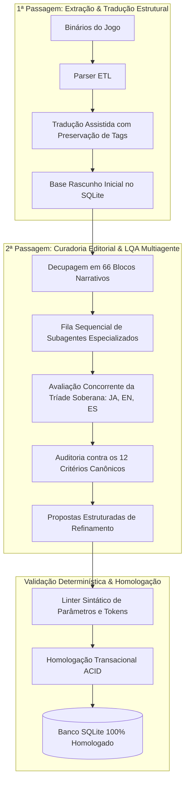

# Engenharia de IA Multiagente & Curadoria Editorial LQA

Este documento descreve a concepção, os desafios de orquestração e os resultados da aplicação de **Sistemas de Agentes Autônomos (Agentic Workflows)** na localização e garantia de qualidade linguística (LQA) de mais de 16.000 falas para *The Adventures of Elliot: The Millennium Tales*.

---

## 1. O Desafio de Localização em Jogos Narrativos

RPGs de ação japoneses apresentam complexidades que sistemas tradicionais de Machine Translation (MT) ou LLMs com prompts simplistas são incapazes de resolver satisfatoriamente:
- **Divergência Dramática entre Idiomas:** A versão em inglês frequentemente sanitiza a personalidade dos personagens, remove hesitações orientais canônicas (`……`), converte termos de fantasia em clichês genéricos e introduz calques.
- **Limitações Estruturais da Engine:** A Unreal Engine requer que tags de formatação (``, `<action .../>`) e marcadores de interpolação (`{0}`, `%s`, `\n`) sejam mantidos com precisão cirúrgica; qualquer erro sintático fecha o jogo (*crash*) ou corta o texto (*clipping*).
- **Consistência de Longo Prazo:** Termos técnicos, nomes de NPCs, locais e facções precisam se manter 100% consistentes ao longo de mais de 50 horas de roteiro.

---

## 2. A Arquitetura de Curadoria em Duas Passagens

Para atingir a qualidade literária de uma publicação editorial humana, dividimos o pipeline em duas fases rigorosas:

---

## 3. A Hierarquia Soberana da Tríade de Idiomas

A heurística de decisão linguística foi codificada nas diretrizes operacionais dos agentes:

| Idioma | Papel no Pipeline | Critérios Auditados |
|---|---|---|
| **Japonês (`JA`)** | **Autoridade Suprema** | Tom, hesitações expressivas (`……`), nível de polidez/formalidade, nomes originais de lore e termos de interface. |
| **Inglês (`EN`)** | **Balizador Técnico** | Limite espacial de caracteres ocidentais, layout da caixa de texto e referências internas de assets. |
| **Espanhol (`ES`)** | **Balizador Gramatical** | Concordância neolatina de gênero e número, evitando a neutralidade cega do inglês. |

### Exemplo Real de Decisão Editorial da Tríade:
- **Japonês (`JA`):** `ネコとあそぶ` (*Brincar com o gato*)
- **Inglês (`EN`):** `Play with cat`
- **Espanhol (`ES`):** `Jugar con el gato`
- **Tradução Automática Ingênua:** *"Reproduzir com o gato"* (alucinação por falso cognato com reprodução multimídia).
- **Decisão do Agente:** Corrigido imediatamente para **"Brincar com o gato"**, restaurando o sentido original e a intenção lúdica da cena.

---

## 4. O Mecanismo de Handoff Dramático e Janela de Borda

Para manter a coerência de personalidade dos personagens sem sofrer de deriva de contexto ao longo de 66 blocos:
1. **Context Boundary:** Cada agente recebia uma janela de até 300 falas.
2. **Edge Window (Sobreposição):** O agente recebia as últimas 15 falas do bloco anterior como contexto fixo de leitura para entender o ritmo imediato da conversa.
3. **State Handoff:** Cada agente gerava um resumo executivo do estado dramático da cena (quem está falando, qual o conflito atual, quais revelações foram feitas) para o agente seguinte.

---

## 5. Resultados Quantitativos da Curadoria

| Métrica | Valor Auditado |
|---|---|
| Total de Falas Auditadas | **16.909 falas** |
| Blocos Narrativos e Sistêmicos | **66 blocos** (100% concluídos) |
| Propostas de Refinamento Submetidas | **198 propostas** |
| Propostas Homologadas no Banco | **198 propostas (100%)** |
| Erros Sintáticos em Tokens/Tags | **0 (Zero falhas)** |
| Crashes em Runtime | **0 (Zero falhas)** |
