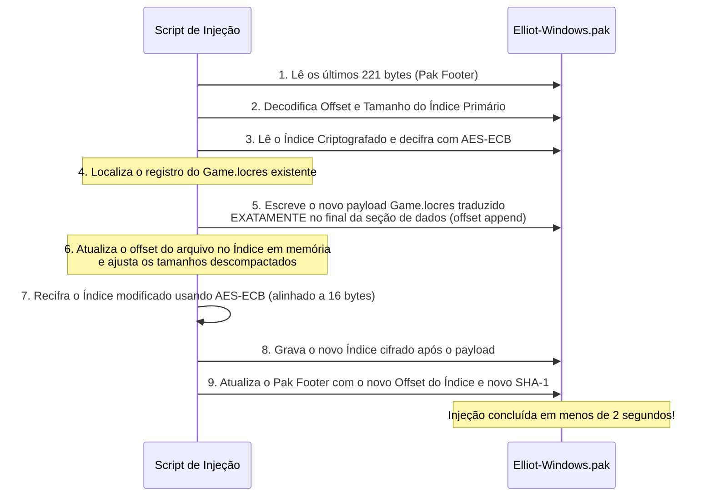

# Engenharia Reversa de Contêineres Unreal Engine (PAK & LocRes)

Este documento detalha os desafios de baixo nível e as soluções algorítmicas desenvolvidas para a injeção binária em tempo de execução no jogo *The Adventures of Elliot: The Millennium Tales*.

---

## 1. O Formato do Arquivo `.pak` da Unreal Engine

O arquivo principal de assets do jogo (`Elliot-Windows.pak`) é um contêiner binário de **3.683.149.111 bytes** (~3,68 GB) estruturado da seguinte forma:

```
+-------------------------------------------------------------+
| DADOS DE ARQUIVOS (Textures, Audio, Locres, UAssets, etc.)  |
| Offset: 0x00000000 até Offset do Índice                    |
+-------------------------------------------------------------+
| ÍNDICE PRIMÁRIO DE ARQUIVOS (Criptografado com AES-ECB)     |
| - Lista de caminhos virtuais                                |
| - Offset absoluto de cada arquivo                           |
| - Tamanho comprimido e não comprimido                       |
| - Método de compressão (zlib)                               |
| - Hash SHA-1 de cada bloco                                  |
+-------------------------------------------------------------+
| PAK FOOTER (221 bytes ao final do arquivo)                  |
| - Assinatura Mágica: 0x5A6F12E1                             |
| - Versão do Formato PAK (v8 / v11)                          |
| - Offset absoluto do Índice Primário                        |
| - Tamanho do Índice Primário                                |
| - Hash SHA-1 do Índice Primário                             |
| - Flag de Criptografia do Índice                            |
+-------------------------------------------------------------+
```

---

## 2. O Desafio da Criptografia AES e o Problema da Recompilação Total

Tentativas ingênuas de localização em Unreal Engine falham tipicamente por duas razões:
1. **Reempacotamento Ingênuo:** Descompactar 3,68 GB de dados e reempacotar via ferramentas genéricas (`UnrealPak.exe`) costuma corromper offsets internos de assets protegidos, além de demorar de 10 a 20 minutos por build e gerar arquivos incompatíveis com a chave de proteção do executável do jogo.
2. **Encriptação do Índice:** O índice de arquivos é cifrado utilizando o algoritmo **AES-128/256 no modo ECB**, exigindo alinhamento estrito em blocos de 16 bytes e preservação de padding determinístico.

---

## 3. A Solução: Injeção Atômica com Criptografia Reversa (v2)

Em vez de reconstruir o contêiner inteiro, o script `src/build_pak_reinsertion.py` implementa uma técnica cirúrgica de baixo overhead:



### Vantagens Desta Abordagem:
- **Tempo de Execução:** Executa em **~1,8 segundos**, contra 15 minutos de um repack completo.
- **Segurança de Dados:** Não toca em 99,9% dos bytes originais do jogo (malhas 3D, shaders, músicas).
- **Rollback 100% Determinístico:** Como os dados originais permanecem intactos nos primeiros 3,68 GB, a restauração para o estado original é feita simplesmente truncando o arquivo de volta ao tamanho exato de fábrica (`3.683.149.111 bytes`), garantindo restauração com hash SHA-256 idêntico ao original.

---

## 4. O Formato Binário `Game.locres`

O arquivo `Game.locres` (Localization Resource) armazena os pares namespace-chave-texto internacionalizados. O módulo `src/locres.py` implementa o parser e empacotador de formato nativo:
- Leitura do GUID de versão de cabeçalho (`LocResVersion`).
- Tabela de strings de namespace em array sequencial.
- Tabela de hashes de chaves e referências de strings com suporte híbrido para strings codificadas em UTF-8 (tamanho positivo) ou UTF-16 LE (tamanho negativo com terminação nula dupla).
