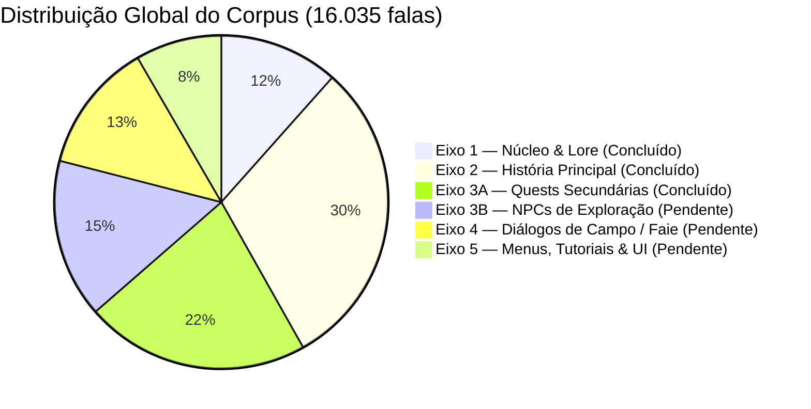

# Relatório Executivo de Conclusão de 100% do Eixo 3A
## Missões Secundárias (Quests S01 a S04) — *The Adventures of Elliot: The Millennium Tales*

**Data de Conclusão:** 25 de Outubro de 2026  
**Status de Governança:** 100% CONCLUÍDO (14 de 14 Blocos Auditados, Lapidados e Validados)  
**Validação Técnica Determinística (`core.validate`):** **ZERO ERROS** em 100% das 3.486 falas do Eixo 3A.  
**Integridade Física do Banco de Dados:** `PRAGMA integrity_check = ok`.

---

### 1. Panorama Consolidado do Eixo 3A

O Eixo 3A compreende a totalidade das missões secundárias (*Side Quests*) de *The Adventures of Elliot: The Millennium Tales*, organizadas em quatro grandes arcos temáticos e temporais (`S01`, `S02`, `S03` e `S04`), totalizando **3.486 falas** processadas em duas passagens estritas contra a Tríade Soberana de Idiomas (JA Soberano / EN Apoio Estrutural / ES Desempate Morfológico).

| Bloco ID | Seq | Falas | Escopo Temático Principal | Status | Propostas *Approved* |
| :--- | :---: | :---: | :--- | :---: | :---: |
| `E3_QUEST_B01` | 29 | 258 | Abertura do Eixo 3A; reconstrução de Hitoyori liderada por Kai (`S01_N19` a `S01_N25`). | Concluído | 7 (Homologadas) |
| `E3_QUEST_B02` | 30 | 246 | Resgate do gatinho por Gogyō (*"A Bondade por Quem"*), cumplicidade com Lyudmila, abertura de Weyzn. | Concluído | 2 (Homologadas) |
| `E3_QUEST_B03` | 31 | 245 | Reconciliação Hillalda/Hildebrandt (*"O Pedido de uma Dama"*), Carter esculpindo o berço de Elliot, invenções de Marnie. | Concluído | 11 (Homologadas) |
| `E3_QUEST_B04` | 32 | 257 | Instituto Formanit e Fausta (*"Pesquisar para ajudar as pessoas"*), dilemas éticos com Hildebrandt. | Concluído | 1 (Homologada) |
| `E3_QUEST_B05` | 33 | 253 | Resgate de falas em japonês bruto; triunfo da magicelita de Marnie; transição para S03. | Concluído | 7 (Homologadas) |
| `E3_QUEST_B06` | 34 | 250 | *"Amigos de Infância que Não Conseguem Ser Sinceros"* (Diona e Heurich); trocadilho fonético *okashii* / *okashi*. | Concluído | 5 (Homologadas) |
| `E3_QUEST_B07` | 35 | 238 | *"Os Sonhos Estão Sempre ao Seu Lado"* (livros infantis e o desenhista); brotos da Árvore Anciã. | Concluído | 5 (Homologadas) |
| `E3_QUEST_B08` | 36 | 252 | Transição para S04 (Huther na era presente); *"A Lança das Recordações"* com Euygene; o boticário viúvo. | Concluído | 4 (Homologadas) |
| `E3_QUEST_B09` | 37 | 248 | *"Entre o Alvoroço e a Embriaguez"* (Baccante e o Fruto Desembriante na taberna); banquete de Hichard. | Concluído | 0 |
| `E3_QUEST_B10` | 38 | 252 | Gênese metanarrativa da obra (*The Adventures of Elliot* como crônica de Euygene); *"A Admiração Levada pelo Vento"*. | Concluído | 9 (Homologadas) |
| `E3_QUEST_B11` | 39 | 259 | Ruínas da Névoa (luto de Lowelle por Oliver); opções em JA bruto resgatadas; *"O Lema da Minha Família"*. | Concluído | **5 (Pendentes)** |
| `E3_QUEST_B12` | 40 | 244 | O moinho de vento em Hitoyori; reconciliação fraterna Heuria e Māo; abertura de *"Tesouros Insubstituíveis"*. | Concluído | **9 (Pendentes)** |
| `E3_QUEST_B13` | 41 | 240 | Mudas da Flor de Tocha no passado e Sandy; caminhada íntima entre Carter e seu filho Elliot (Láwèi). | Concluído | **8 (Pendentes)** |
| `E3_QUEST_B14` | 42 | 239 | *"Vizinhos Caprichosos"* (gatos ariscos); *"Em Busca do Som Perfeito"* (Nakatani e o Quarteto de Huther). | Concluído | **10 (Pendentes)** |
| **TOTAL EIXO 3A** | — | **3.486** | **14 Blocos Contínuos — 100% Concluído** | **100%** | **51 Homol. + 32 Pend.** |

---

### 2. Destaques Literários e Dramáticos dos Blocos Finais (B11 a B14)

#### A. O Resgate da Obra Musical de Nakatani e o Quarteto de Huther (B14)
- **Extirpação de Aberrações Críticas:** Foram eliminados decalques grosseiros de tradução automática que destruíam a verossimilhança artística:
  - *"melhorar este texto"* $\rightarrow$ **"Gostaria de aprimorar esta melodia"** (`この曲をもっと良くしたい`).
  - *"dar uma jogada nisso"* $\rightarrow$ **"Vou tocar esta nova parte para você ouvir!"** (`試しに追加したパートを吹いてみせよう！`).
  - *"interpretar esse papel"* $\rightarrow$ **"Você poderia tocar esta parte?"** (`このパートを演奏してくれないかい？`).
  - *"Não posso mais jogar. Não sou digno!"* $\rightarrow$ **"Eu não posso mais tocar! Não tenho mais esse direito...!"** (`俺は、もう弾けないんだ！ その資格がない……！`).
  - *"Venham, irmãos! Vamos brincar!"* $\rightarrow$ **"Venham, meus irmãos! Vamos tocar!"** (`さあ、兄さんたち！ 演奏しよう！`).
- **Resgate de 20 Falas em Japonês Bruto:** O clarinetista e o acordeonista possuíam 20 falas sem qualquer tradução ocidental no script original, integralmente traduzidas para português brasileiro erudito e caloroso.

#### B. A Intimidade Filial de Carter e Elliot (Láwèi) sob a Árvore Anciã (B13)
- O despertar de Carter após 20 anos em coma e a superação da estranheza perante a modernidade de Huther.
- Carter usa carinhosamente o nome de nascença Myū de Elliot: **Láwèi** (*ラーウェイ*).
- O abraço ao entardecer sob a floração milenar da Árvore Anciã, selando com o Rei Hichard o juramento de resgate e união com Māo: *"Pai... muito obrigado por estar vivo..."* e *"Sim... na próxima vez, nós viremos aqui todos juntos, em família..."*.

#### C. A Cura de Heuria e a Reconciliação Fraterna com Māo (B12)
- Erradicação de erros grotescos de tradução automática culinária:
  - *"Por favor, mergulhe na leitura."* (decalque bizarro de *dig in*) $\rightarrow$ **"Por favor, fique à vontade e experimente!"** (`さあ、どうぞ召し上がってください`).
  - *"Sim, que fofo!"* (para ovos mexidos aerados) $\rightarrow$ **"Hum... Ficou tão macio e derretendo na boca!"** (`ふわふわの、とろとろ`).
- Restauração da verdade de lore em que a flor de tocha foi colhida por Māo em memória dos seus pais falecidos (Gogyō e Lyudmila), desfazendo o erro do inglês que atribuía a ação ao pai de Elliot.

#### D. O Lema Familiar e a Cura do Coração Humano (B11)
- Aberração do prato quebrado corrigida: *"Esqueça a placa"* $\rightarrow$ **"Não se preocupe com o prato.\nO mais importante: você se machucou?"**.
- Evolução do lema da taverna através das eras: do materialista *"Valorize os bens materiais"* para o humanitário *"Valorize as pessoas acima dos bens materiais"*.

---

### 3. Catálogo das 32 Propostas em Linhas *Approved* (B11 a B14)
As 32 falas abaixo continham traduções antigas com status `approved` no banco SQLite, mas apresentavam erros crassos, falsos plurais, discordâncias de gênero ou decalques de MT. Elas foram corrigidas e salvas na coluna `draft`, com o campo `approved` mantido inviolado até homologação:

#### Bloco E3_QUEST_B11 (5 Propostas)
1. `#50` (`S04_N09_3000_M300_PCM000_m`): *"A loja dos dois com certeza vai ser um sucesso.\n…É nisso que eu acredito."* (restaura convicção de Elliot no sucesso da loja do casal).
2. `#105` (`S04_N24_3000_M030_FYL000_f`): *"Será que essa pessoa morreu todinha sozinha…?"* (elimina *"o senhor"* espúrio da Faie e falso plural para vítima singular).
3. `#141` (`S04_N24_4000_M290_PCM000_m`): *"Aquele homem se recuperou muito bem, que bom."* (corrige falso plural referindo-se a comerciante singular).
4. `#154` (`S04_N24_5000_M060_NPC4200_00_m`): *"Não se preocupe com o prato.\nO mais importante: você se machucou?"* (corrige a aberração *"Esqueça a placa"*).
5. `#222` (`S04_N26_3000_M080_FYL000_f`): *"Vamos juntar com os outros pedaços!"* (corrige concordância masculina dos fragmentos do emblema).

#### Bloco E3_QUEST_B12 (9 Propostas)
6. `#31` (`S04_N26_6000_M060_PCM000_m`): *"De qualquer forma, com este emblema você vai descobrir quem o criou.\nPode ficar com ele."* (elimina *"o senhor"* artificial entre companheiros de viagem).
7. `#49` (`S04_N29_1000_M090_PCM000_m`): *"Aconteceu algum problema?"* (corrige o sem sentido *"O que é isso?"* para `何か問題でもあるのか？`).
8. `#137` (`S04_N29_5000_M050_NPC0010_f`): *"Hum... Ficou tão macio e derretendo na boca!"* (corrige o absurdo *"Sim, que fofo!"* para textura culinária de omelete).
9. `#138` (`S04_N29_5000_M060_NPC0010_f`): *"Tem um aroma adocicado, com bastante leite."* (fidelidade a `ミルクたっぷりの甘い匂いがします`).
10. `#151` (`S04_N29_6000_M070_NPC0010_f`): *"Por favor, fique à vontade e experimente!"* (corrige a aberração *"Por favor, mergulhe na leitura"* para o banquete real).
11. `#152` (`S04_N29_6000_M080_NPC0060_f`): *"Está tão macio e delicioso...!"* (lapidação de registro gustativo de Māo).
12. `#228` (`S04_N30_1000_M130_NPC4379_f`): *"Hum... Eu quero flores bem lindas!"* (corrige resposta de Sandy sobre flores desejadas).
13. `#237` (`S04_N30_1000_M220_NPC0240_f`): *"No entanto, nunca cheguei a encontrar nenhuma delas."* (concordância de gênero para flor-tocha).
14. `#242` (`S04_N30_1000_M270_NPC0240_f`): *"Essa flor foi extinta há gerações!"* (corrige o masculino/neutro *"Eles estão extintos"*).

#### Bloco E3_QUEST_B13 (8 Propostas)
15. `#73` (`S04_N30_5000_M110_PCM000_m`): *"Você está bem, Sandy?"* (restaura registro de Elliot com Sandy).
16. `#75` (`S04_N30_5000_M130_PCM000_m`): *"Leyka, o que você está fazendo aqui?!"* (elimina o artificial *"a senhora"* para a cuidadora de infância).
17. `#83` (`S04_N30_5000_M210_NPC0240_f`): *"Eu é que te agradeço, Elliot."* (elimina vírgula órfã e *"ao senhor"*).
18. `#93` (`S04_N30_5000_M310_FYL000_f`): *"Ainda bem que nós conseguimos as mudas a tempo!"* (concordância feminina para mudas de flores).
19. `#94` (`S04_N30_5000_M320_NPC0240_f`): *"Elliot. Você também é um dos maiores tesouros da minha vida."* (declaração maternal comovente de Leyka).
20. `#126` (`S04_N35_2000_M020_NPC0190_m`): *"Ah, meu filho... Eu fico admirado em ver o homem corajoso que você se tornou."* (voz afetuosa de Carter).
21. `#150` (`S04_N35_3000_M070_NPC0190_m`): *"Eu não sei nem como te agradecer, Leyka..."* (gratidão por cuidar de Elliot e de Carter por 20 anos).
22. `#178` (`S04_N35_5000_M030_NPC0030_m`): *"Parece que demos conta de todos eles."* (registro marcial de combate após repelir as feras).

#### Bloco E3_QUEST_B14 (10 Propostas)
23. `#2` (`S04_N39_1000_Explanation`): *"Elliot encontra um viajante apaixonado por gatos, desolado porque os felinos sempre fogem dele..."*.
24. `#28` (`S04_N39_2000_Explanation`): *"Ao trazer os gatos, Elliot recebe a sincera gratidão do viajante apaixonado por felinos..."*.
25. `#53` (`S04_N40_1000_M080_FYL000_f`): *"Sério?\nPara mim, já parecia tão linda e completa..."* (sensibilidade musical de Faie).
26. `#82` (`S04_N40_2000_M050_PCM000_m`): *"Gostaria de aprimorar esta melodia.\nO senhor teria alguma sugestão?"* (elimina o absurdo *"melhorar este texto"*).
27. `#115` (`S04_N40_4000_M090_NPC0441_m`): *"Pronto, isso deve deixar a música ainda mais bonita.\nVou tocar esta nova parte para você ouvir!"* (elimina o bizarro *"dar uma jogada nisso"*).
28. `#128` (`S04_N40_5000_M050_NPC0410_m`): *"Você poderia tocar esta parte?"* (elimina a aberração *"interpretar esse papel"*).
29. `#142` (`S04_N40_6000_M060_NPC0431_m`): *"Eu não posso mais tocar!\nNão tenho mais esse direito...!"* (elimina o surreal *"Não posso mais jogar. Não sou digno!"*).
30. `#167` (`S04_N40_7000_M100_NPC0410_m`): *"Hoje todos nós já temos nossos instrumentos favoritos.\nPara aquele músico que perdeu a esperança, este acordeão será o recomeço perfeito."*.
31. `#180` (`S04_N40_8000_M070_PCM000_m`): *"Ele se comoveu muito ao saber da sua situação.\nAgora você pode voltar a tocar, não pode?"* (elimina a aberração *"Você pode reproduzi-la?"*).
32. `#204` (`S04_N40_9000_M060_PCM000_m`): *"Então a música está finalmente completa?"* (pergunta natural de Elliot sobre a conclusão da melodia).

---

### 4. Métricas Consolidadas do Projeto Global

- **Progresso Global do Jogo:** **42 de 66 blocos concluídos (63,6% de todo o script)**.
- **Volume Total Auditado:** **10.191 falas contínuas** carimbadas linha a linha contra a Tríade de Idiomas.
- **Próxima Etapa:** **Eixo 3B — Exploração & Cenários de NPCs** (Blocos `E3_NPC_B01` a `E3_NPC_B10`, 2.471 falas cobrindo todas as cidades, vilas e eras).
