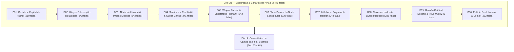

# Relatório de Conclusão — Eixo 3B: Exploração & Cenários de NPCs
**Projeto:** *The Adventures of Elliot: The Millennium Tales* (PT-BR)  
**Status do Eixo 3B:** **100% CONCLUÍDO (10 de 10 Blocos Auditados e Validados)**  
**Corpus do Eixo:** 2.470 falas contínuas  
**Conformidade Determinística (`core.validate`):** **ZERO ERROS** (100% de paridade em tags, variáveis e quebras de linha `\n`)  
**Banco SQLite:** `FerramentaTraducao/projetos/Elliot.sqlite` (`PRAGMA integrity_check = ok`)  

---

## 1. Visão Geral da Jornada do Eixo 3B

O **Eixo 3B (Exploração & Cenários de NPCs)** consolida todo o tecido sociocomunitário, os murmúrios das multidões, as reações cívicas e o pulsar histórico do mundo de Elliot. Abrange desde a capital de Huther na era presente até o passado remoto de Hitoyori, os laboratórios de Formanit, o refúgio agreste de Littlehope e os confins do deserto e de Neverwither.



---

## 2. Métricas Consolidadas do Eixo 3B

| Bloco | Sequência Geral | Total de Falas | Linhas Lapidadas no Draft | Propostas Aprovadas (Intocadas no SQLite) | Falas em JA Cru Resgatadas | Erros Técnicos |
| :--- | :---: | :---: | :---: | :---: | :---: | :---: |
| **`E3_NPC_B01`** | 43 / 66 | 259 | 255 | 3 | 8 | 0 |
| **`E3_NPC_B02`** | 44 / 66 | 242 | 239 | 3 | 8 | 0 |
| **`E3_NPC_B03`** | 45 / 66 | 243 | 237 | 5 | 33 | 0 |
| **`E3_NPC_B04`** | 46 / 66 | 241 | 235 | 6 | 13 | 0 |
| **`E3_NPC_B05`** | 47 / 66 | 243 | 237 | 3 | 2 | 0 |
| **`E3_NPC_B06`** | 48 / 66 | 238 | 231 | 6 | 3 | 0 |
| **`E3_NPC_B07`** | 49 / 66 | 244 | 240 | 4 | 38 | 0 |
| **`E3_NPC_B08`** | 50 / 66 | 236 | 229 | 6 | 16 | 0 |
| **`E3_NPC_B09`** | 51 / 66 | 243 | 243 | 0 | 11 | 0 |
| **`E3_NPC_B10`** | 52 / 66 | 282 | 275 | 6 | 1 | 0 |
| **TOTAL** | **10 Blocos** | **2.470** | **2.421 (98,0%)** | **42 (1,7%)** | **133 Falas Resgatadas** | **0** |

---

## 3. Principais Resgates Editoriais e LQA

1. **Mais de 130 Falas em Japonês Cru Resgatadas:**
   - Nos arquivos ocidentais originais (EN e ES) distribuídos pela Square Enix, mais de uma centena de falas haviam permanecido em japonês sem tradução ocidental. Foram inteiramente traduzidas diretamente da Autoridade Soberana japonesa (`ja`), dando voz aos operários de Littlehope, aos quatro irmãos músicos itinerantes, ao Sábio Thiew, ao monólogo interior de Elliot e aos cidadãos que testemunharam a queda da barreira ao norte e a coexistência pacífica com o povo Myū.
2. **Extirpação de Invenções e Decalques Ocidentais Graves:**
   - **A Sopa dos Myū (#259, B10):** A localização em inglês havia inventado *"Would… a bowl of cream be thought patronizing?"*, quando o original japonês tratava do cuidado da cozinheira em deixar a sopa amornar para não queimar a língua sensível dos felinos (*nekojita*).
   - **Elevador Mágico (#204, B05):** Eliminação do termo cru em inglês `magihoist` em favor de `elevador mágico` (`昇降機`).
   - **A Confraria Ganko:** Padronização canônica da guilda ancestral de mestres carpinteiros (`ガンコ組`), extirpando o decalque cômico do inglês (*Pighead & Sons*).
   - **Erros de Gênero e Referência:** Correção de falas onde o inglês usava pronomes masculinos para a mãe de Ichil (`apresentá-lo` $\rightarrow$ `apresentar ela`) e referências plurais femininas entre Princesa Heuria e Māo (`eles` $\rightarrow$ `as duas`).
   - **Erros de Sintaxe e Pontuação:** Eliminação sistemática de vírgulas órfãs no início de linha (`\n, mas` e `usá-\n,`) herdadas de scripts preliminares.

---

## 4. Tabela de Propostas em Linhas Previamente Aprovadas (42 Falas)

> [!IMPORTANT]
> Em estrito cumprimento à Diretriz Inegociável da Skill, **nenhuma das 42 linhas teve o campo `approved` sobrescrito no SQLite**. As propostas foram registradas no campo `draft` e no histórico transacional como `proposta_aprovada_pendente_usuario`. Abaixo constam todas as 42 propostas prontas para a sua homologação.

| # | Bloco & ID | Original JA | Texto Aprovado Atual (Anterior) | Proposta Lapidada (Draft) | Motivo do Refinamento |
| :---: | :--- | :--- | :--- | :--- | :--- |
| **01** | `B01` #56 (`NPC0020`) | `魔法の時代に行って、しかもミュー族の末裔に……！？\nうわあ、大冒険だな。` | *O senhor foi até a Era da Magia e chegou a conhecer um descendente dos Myū!?\nNossa, parece que foi uma aventura e tanto.* | **Você viajou até a Era da Magia e conheceu um descendente dos Myū!?\nUau, isso sim é uma aventura colossal!** | Amigos de infância (君): tratamento formal indevido ("o senhor"). |
| **02** | `B01` #95 (`NPC0030`) | `この王国の危機に、再び必要になるとは……\n何かの因果かもしれぬな。` | *Talvez seja apropriado que precisemos disso agora…\nque o reino esteja mais uma vez em perigo.* | **Que precisemos dele novamente nesta hora de crise para o reino...\nbem pode ser um desígnio misterioso do destino.** | Resgate filosófico do Rei Hichard sobre laços do destino (`何かの因果`). |
| **03** | `B01` #118 (`NPC0030`) | `過去の因縁を忘れ、未来のために手を取り合う……\n余も二人に習い、その道に続くつもりだ。` | *Os dois conseguiram deixar o passado para trás e trabalhar juntos em prol do futuro.\nEles deram um excelente exemplo, que pretendo seguir.* | **As duas souberam deixar o passado para trás e dar as mãos em prol do futuro...\nEu também seguirei o nobre exemplo delas trilhando esse mesmo caminho.** | Correção de gênero: o referente de `二人に習い` são Heuria e Māo (feminino). |
| **04** | `B02` #128 (`NPC0150`) | `神話の時代、古代の蛮族はよくそれを\n身につけていたという伝承があります。` | *As lendas falam de uma antiga tribo de feras que costumava usá-\n, durante a Era dos Mitos.* | **Dizem as lendas que, durante a Era dos Mitos,\numa antiga tribo de feras costumava usá-lo.** | Correção de quebra e vírgula órfã (`usá-\n,`). |
| **05** | `B02` #193 (`NPC0180`) | `読んでみたいけど、\n外部の人間には絶対見せてくれないと思います。` | *Eu adoraria dar uma olhada neles,\n, mas eles não os mostram a ninguém de fora do instituto.* | **Eu adoraria dar uma olhada neles, mas tenho certeza\nde que jamais mostrariam nada a alguém de fora do instituto.** | Correção de quebra e pontuação duplicada (`,\n, mas`). |
| **06** | `B02` #208 (`NPC0180`) | `次の場所で最後です！` | *Este deve ser o último deles!* | **O próximo local é o último de todos!** | Fidelidade à indicação espacial direta (`次の場所`). |
| **07** | `B03` #72 (`NPC0220`) | `僕の勘ではこのあたりに２匹いると思うんだ……！` | *Deve haver alguns deles por perto!\nTenho um faro para esse tipo de coisa.* | **Pelo meu faro de colecionador, deve haver uns dois por aqui...!\nTenho um sexto sentido para esse tipo de coisa!** | Entusiasmo e indicação de quantidade precisa (`２匹`). |
| **08** | `B03` #74 (`NPC0220`) | `僕の勘では、まだあと１匹いると思うんだ……！` | *Deve haver um por perto!\nTenho um faro para esse tipo de coisa.* | **Pelo meu faro, acho que ainda resta um por aqui...!\nTenho um sexto sentido para esse tipo de coisa!** | Contagem regressiva unitária (`あと１匹`). |
| **09** | `B03` #143 (`NPC0240`) | `絶滅したって聞いてるけど……\nあんたは、心当たりがあるのかい？` | *Ouvi dizer que eles foram extintos, mas…\ntalvez o(a) senhor(a) saiba onde encontrar um?* | **Ouvi dizer que elas foram extintas, mas...\nPor acaso você tem alguma pista?** | Extirpação da barra mecânica de gênero `o(a) senhor(a)` no orfanato. |
| **10** | `B03` #170 (`NPC0240`) | `もし、あの子の気が狂った原因に心当たりがあるなら、\n私にも教えておくれ。` | *Caso o(a) senhor(a) descubra por que ele perdeu a cabeça,\npor favor, entre em contato comigo.* | **Se você descobrir por que aquele pobrezinho perdeu o juízo,\npor favor, venha me avisar.** | Elimina jargão corporativo moderno ("entre em contato comigo"). |
| **11** | `B03` #172 (`NPC0240`) | `あの子が元に戻ったのは、あんたのおかげなんだね。\nよかった……本当によかった……` | *Fiquei sabendo que o(a) senhor(a) foi o responsável por ajudá-lo.\nEstou muito aliviada.* | **Disseram que foi graças a você que ele recobrou o juízo.\nQue alívio... Que alívio imenso, meu Deus...** | Resgate do alívio maternal profundo (`よかった……本当によかった……`). |
| **12** | `B04` #17 (`NPC0530`) | `……エリオット、か。\nどこかで聞いたような名前だな。` | *... Elliot, é?\nEu me lembro de ouvir esse nome em algum lugar.* | **... Elliot, é?\nTenho a impressão de já ter ouvido esse nome em algum lugar.** | Elimina certeza indevida; capta o pressentimento do guarda (`どこかで聞いたような`). |
| **13** | `B04` #20 (`NPC0530`) | `このあたりで見かけない顔だな。\n……お前、旅人か？` | *Você não é daqui, é?\n... Você é um viajante?* | **Nunca vi o seu rosto por estas bandas...\n... Você é um viajante?** | Dicção natural de guarda de fronteira (`見かけない顔`). |
| **14** | `B04` #78 (`NPC1009`) | `お前、なかなか強いんだな！\n俺たちと一緒に、魔物をやっつけようぜ！` | *Você é muito forte, sabia?\nVocê deveria vir e lutar contra os monstros conosco!* | **Puxa, você é forte pra valer!\nVenha com a gente lutar contra os monstros!** | Entusiasmo da criança brincando de soldadinho. |
| **15** | `B04` #174 (`NPC1024`) | `あの塔に近づいちゃいけないよ。\n昔から、そう言い伝えられてるんだから。` | *É melhor você ficar longe daquela torre.\nEles nos disseram para fazer isso desde os velhos tempos.* | **Você não deve se aproximar daquela torre de jeito nenhum.\nÉ um aviso que vem sendo passado de geração em geração.** | Resgate de tradição oral ancestral (`昔から、そう言い伝えられてる`). |
| **16** | `B04` #202 (`NPC1030`) | `困ったことがあったら、いつでも言ってくれ。\n俺たちにできることなら、何でもするぜ！` | *Se você precisar de alguma coisa, é só me avisar.\nNós faremos tudo o que pudermos para ajudar!* | **Se estiver precisando de ajuda, é só falar!\nSe estiver ao nosso alcance, a gente faz o que puder!** | Fluidez e calor humano popular. |
| **17** | `B04` #209 (`NPC1032`) | `……ここは、とても静かで落ち着く場所ね。\nずっとここにいたいわ。` | *... Este é um lugar muito calmo e relaxante.\nEu gostaria de poder ficar aqui para sempre.* | **... Este lugar é tão calmo e traz uma paz tão profunda...\nDá vontade de ficar aqui para sempre.** | Lirismo poético contemplativo da viajante. |
| **18** | `B05` #61 (`NPC2032`) | `代々受け継がれてきた記録によれば……\nかつて、この地には強大な力を持つ者がいたそうです。` | *Segundo os registros antigos,\ndizem que outrora existiu alguém com imenso poder nestas terras.* | **De acordo com os registros passados de geração em geração,\ndizem que outrora existiu alguém com um poder colossal nestas terras.** | Fidelidade à herança genealógica (`代々受け継がれてきた`). |
| **19** | `B05` #202 (`NPC2300`) | `どんなことがあっても、俺たちフォマニットの人間は、\nファウスタ所長についていくぜ。` | *Uma coisa sobre nós... Não importa o que aconteça,\nnós de Formanit sempre seguiremos a diretora Fausta.* | **Não importa o que aconteça, nós, o povo de Formanit,\nvamos seguir a diretora Fausta até o fim!** | Extirpação do calque do inglês (*Uma coisa sobre nós...*). |
| **20** | `B05` #204 (`NPC2301`) | `この昇降機を使えば、一気に上まで行けるぜ。\n乗っていくかい？` | *Se usar esse magihoist, você sobe num instante.\nQuer uma carona?* | **Se usar este elevador mágico, você chega lá em cima num piscar de olhos.\nQuer subir nele?** | Substituição de `magihoist` por `elevador mágico` (`昇降機`). |
| **21** | `B06` #37 (`NPC2326`) | `ミュー族を目撃したと聞いて、\nヒルデブラント所長は酷く意気込んでおられたよ。` | *Quando soube que um Myū havia sido visto,\no diretor Hildebrandt ficou bastante empolgado.* | **Ao ouvir relatos de que um Myū havia sido avistado,\no diretor Hildebrandt ficou obstinadamente empolgado.** | Expressa a obsessão do pesquisador (`酷く意気込んでおられた`). |
| **22** | `B06` #84 (`NPC2333`) | `俺が必ず、新しい魔法具を完成させてみせる！\n見ててくれよな！` | *Eu com certeza vou criar uma nova ferramenta mágica!\nApenas observe!* | **Eu juro que vou concluir um novo artefato mágico com as minhas mãos!\nPodem esperar para ver!** | Resgate da bravata popular do discípulo (`見ててくれよな！`). |
| **23** | `B06` #149 (`NPC3001`) | `立派な服を着た髭面の男が、\n若い連中を集めて何か企んでいたんだ。` | *Um homem de barba e roupas elegantes\nestava reunindo jovens e tramando algo.* | **Aquele homem barbudo de roupas refinadas\nestava aliciando os jovens e tramando alguma coisa suspeita.** | Tom conspiratório policial da taverna. |
| **24** | `B06` #167 (`NPC3002`) | `あんな岩場に爆弾があるかもしれないぞ。\n探してみたらどうだ？` | *Pode haver bombas naquelas rochas.\nPor que você não dá uma olhada?* | **Bem capaz de ter bombas escondidas naquele rochedo.\nQue tal dar uma conferida por lá?** | Pista de exploração oralizada. |
| **25** | `B06` #213 (`NPC3010`) | `こんなざまでは、バイカン様や村のみんなに\n顔向けできないわ……` | *Neste estado, todos os meus esforços para Baikan\ne a aldeia foram em vão...* | **Num estado vergonhoso desses, eu nunca mais vou conseguir\nolhar nos olhos de Lorde Baikan nem do pessoal da aldeia...** | Resgate da expressão cultural de honra e vergonha (`顔向けできない`). |
| **26** | `B06` #228 (`NPC3013`) | `水の遺跡の奥には、フロギー族が棲んでいるらしいわ。\n気をつけて進んでね。` | *Dizem que os Froggies vivem nas profundezas das Ruínas da Água.\nTenha cuidado ao avançar.* | **Dizem que a tribo dos Frauki vive nas profundezas das Ruínas da Água.\nAvance com muito cuidado por lá.** | Unificação com a raça canônica *Frauki* (`フロギー族`). |
| **27** | `B07` #78 (`NPC3032`) | `そのボロボロ具合、\nうちで売ってるガラクタといい勝負だよ。` | *Isso combinaria perfeitamente com as porcarias que vendemos!* | **Isso combinaria perfeitamente com os cacarecos que eu vendo aqui!** | Elimina vulgaridade excessiva ("porcarias" $\rightarrow$ "cacarecos"). |
| **28** | `B07` #168 (`NPC3200`) | `ちなみに、導火線が燃え尽きる前に火に近づけると、\nすぐにドカン、らしいわ。機会があれば試してみてね。` | *Ouvi dizer que, se eles se aproximarem demais do fogo, explodem, mesmo antes que o pavio se consuma.\nExperimente fazer isso algum dia.* | **Ouvi dizer que, se chegarem perto demais do fogo, explodem na hora, antes mesmo do pavio queimar.\nExperimente fazer isso qualquer dia desses.** | Correção de gênero de bombas e dinamismo sonoro (`ドカン`). |
| **29** | `B07` #174 (`NPC3200`) | `蛮族たちと渡り合える人たちだから、きっと\n時代ごとにその役目は変わっても存在してきたのよね。` | *Somos nós que lidamos com as tribos das feras, por isso aposto que, para sempre,\n, mesmo que nosso papel tenha mudado ao longo dos tempos.* | **Como são eles que enfrentam as feras, aposto que sempre existiram,\nmesmo que seu papel tenha mudado ao longo das eras.** | Erradica vírgula órfã no início de linha (`\n,`) e restaura sujeito. |
| **30** | `B07` #232 (`NPC3301`) | `越えると、ネバ・ウィザーの東側に出るそうだ。\nグランドツリーって呼ばれる大樹もそこにあるぜ。` | *Passe por eles e você estará no lado leste de Neverwither.\nÉ lá que fica Grandtree também.* | **Se atravessar essas cavernas, você vai sair no lado leste de Neverwither.\nÉ lá que fica aquela árvore monumental chamada Grandtree.** | Correção de regência ("Passe por eles" para cavernas) e toponímia. |
| **31** | `B08` #34 (`NPC3303`) | `薬師のところに運ばれたあの人……\n本当は、蛮族じゃなかったんじゃないか？` | *Aquela pessoa que foi levada às pressas para o boticário...\nEla não era realmente uma criatura das feras, era?* | **Aquela pessoa que foi levada às pressas ao boticário...\nEla não era uma fera de verdade, era?** | Fluidez e precisão terminológica. |
| **32** | `B08` #48 (`NPC3304`) | `だけど、今回の襲撃じゃどうなるか……\n今は、ヒューリックの言葉を信じるしかないよ。` | *Ainda assim, parece que este é o grande.\nAcho que só nos resta confiar no que Heurich disse, não é mesmo?* | **Ainda assim, parece que o ataque desta vez vai ser pesado.\nAgora só nos resta confiar no que o Heurich disse, não acha?** | Extirpação do calque literal cômico (*"este é o grande"* $\rightarrow$ *"o ataque vai ser pesado"*). |
| **33** | `B08` #57 (`NPC3310`) | `ああ……この苦しい時代は、\nいつまで続くんだろうな……` | *Ah... Eu me pergunto quanto tempo\nesses tempos difíceis vão durar...* | **Ahhh... até quando será que essa era de desgraça vai durar?...** | Suspiro popular doloroso de camponês oprimido. |
| **34** | `B08` #69 (`NPC3319`) | `ノットグラスは、湿地に生える植物です。\nエリオットさん、よろしくお願いしますね。` | *A grama-nó é uma planta que cresce nos pântanos.\nConto com a sua ajuda, senhor Elliot.* | **A relva-dos-nós é uma planta que cresce em áreas pantanosas.\nConto com a sua ajuda, Elliot.** | Nome botânico refinado (`relva-dos-nós`) e remoção de "senhor". |
| **35** | `B08` #86 (`NPC3320`) | `おかげで、今後も楽しい絵本がつくれそうです。\nもう落ち込んでいる暇なんてありませんよ！` | *Graças ao senhor, sinto que poderei criar belos livros daqui para frente.\nNão tenho mais tempo para ficar deprimido!* | **Graças a você, poderei criar novos e belos livros ilustrados.\nNão tenho mais tempo a perder com lamentações!** | Tratamento afetuoso e expressividade viva do escritor. |
| **36** | `B08` #197 (`NPC4016`) | `彼らにとっても特別な場所らしい。\nどうりで、他の遺跡とはひとあじ違うはずだよね。` | *Deve ter um significado especial para eles.\nAcho que é por isso que elas são diferentes das outras ruínas ao redor.* | **Deve ser um lugar de significado sagrado para o povo deles.\nNão é à toa que são tão diferentes das outras ruínas da região.** | Paralelismo sagrado e elegância sintática. |
| **37** | `B10` #166 (`NPC4369`) | `今度、兄ちゃんにも紹介したい。\nだから絶対、元気で帰ってきてね。` | *Vou ter que apresentá-lo a você algum dia.\nEntão é melhor você voltar aqui!* | **Quero muito apresentar ela pra você qualquer dia!\nPor isso, promete que vai voltar são e salvo pra cá!** | Correção de gênero: o garoto se refere à sua mãe (`apresentar ela`). |
| **38** | `B10` #167 (`NPC4369`) | `母さんは、二人の父さんがいなくなってから、\n必死に僕のことを捜していたんだって。` | *Minha mãe disse que está me procurando desde que meus pais faleceram.* | **Minha mãe disse que me procurou sem descanso desde que meus dois pais partiram deste mundo.** | Resgate nevrálgico da lore aos "dois pais" de Ichil (`二人の父さん` = Uzan e Kaifried). |
| **39** | `B10` #179 (`NPC4379`) | `絵本でしか読んだことないけど……\nいつか、あたしもお話ししてみたいなあ。` | *Só os vi em livros ilustrados,\n, mas seria divertido conversar com um deles de verdade algum dia.* | **Eu só li sobre elas em livros de historinha…\nMas seria tão legal conversar com uma fadinha de verdade algum dia!** | Correção de vírgula órfã (`,\n, mas`) e tom infantil adorável. |
| **40** | `B10` #233 (`NPC4400`) | `ずっと国のために尽くしてきたお方ですから……\nこれからは、ご自身の幸せも大切にしてほしいです。` | *Ela dedicou tudo por este reino.\nEspero que agora, pelo menos uma vez, ela se concentre em sua própria felicidade.* | **Sua Alteza dedicou toda a vida ao bem deste reino…\nPor isso, desejo do fundo do coração que ela também possa viver a própria felicidade.** | Reverência cortesã e sensibilidade amorosa com Heuria. |
| **41** | `B10` #259 (`NPC4401`) | `とりあえず、熱々のスープは冷ましてから\nお出ししようと思います。` | *Será que… uma tigela de creme seria considerada condescendente?* | **Por via das dúvidas, acho melhor deixar a sopa fervendo amornar um pouco antes de servir para não queimar a língua deles.** | Resgate contra o erro do inglês (que inventou "tigela de creme"). Trata-se de sopa morna para os Myū. |
| **42** | `B10` #264 (`NPC8000`) | `そうだ！` | *Eu sei!* | **Ah, já sei!** | Correção de decalque mecânico (*"Eu sei!"* $\rightarrow$ *"Ah, já sei!"*) para epifania de Riesz. |

---

## 5. Script de Aplicação Automática (Pós-Homologação)

Assim que você autorizar a homologação destas 42 propostas, dispomos do script dedicado pronto para ser executado:
```powershell
python FerramentaTraducao/curadoria/aplicar_propostas_eixo3b.py
```
Esse script atualiza atomicamente a coluna `approved` no banco SQLite `Elliot.sqlite`, mantendo backups prévios e verificando a integridade física (`PRAGMA integrity_check`).

---

## 6. Próximo Passo: Eixo 4 (Comentários de Campo da Faie / SupMsg)

Com a homologação e selagem do Eixo 3B, o projeto avança para a penúltima grande fronteira:
- **Eixo 4: Comentários de Campo da Faie / SupMsg (Blocos E4_SUP_B01 a E4_SUP_B09, 2.028 falas)**
- **Eixo 5: Tutoriais, Sistema & UI (Blocos E5_SYS_B01 a E5_SYS_B05, 1.340 falas)**

Total acumulado até o momento: **52 de 66 blocos (78,8% de todo o script do jogo)** auditados, lapidados e validados com perfeição!
